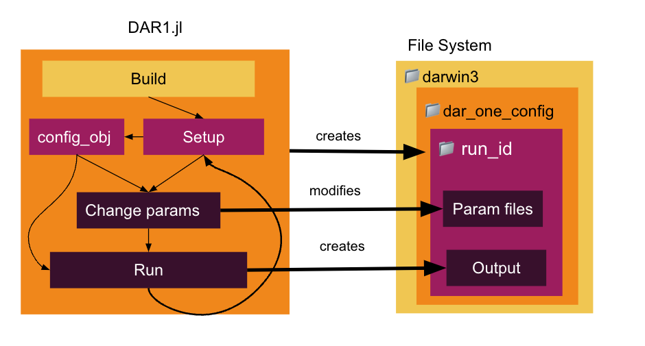

# Getting Started

**DarOne.jl** is a Julia interface to the [MITgcm DARWIN ecosystem model](https://darwinproject.mit.edu/). It supports controlled experiments in a single, well-mixed water parcel or a grid of independent parcels, with configurable nutrients, temperature, light, and plankton communities.


## Components

A DarOne experiment uses three components:

- [DarOne.jl](https://github.com/DarOneModel/DarOne.jl) — the Julia interface for experiment setup, parameters, execution, and diagnostics.
- [Darwin3](https://github.com/darwinproject/darwin3) — the MITgcm-based Fortran ecosystem model.
- [`dar_one_config`](https://github.com/barbara42/dar_one_config) — the Fortran code and model-input configuration for these experiments.

The default configuration represents a well-mixed water parcel with air–sea gas exchange and controlled transport. Experiment-specific input and output directories keep the chosen settings and diagnostics together.



## Installation

Install the Julia package from the General registry:

```julia
import Pkg
Pkg.add("DarOne")
using DarOne
```

To compile and run the Fortran model, install a GNU Fortran compiler, `make`, Python, and the NetCDF C and Fortran development libraries. On Debian/Ubuntu, the system packages include `gfortran`, `make`, `libnetcdf-dev`, and `libnetcdff-dev`.

### Prepare the Darwin3 model source

For the v0.2.0 source layout, clone the pinned Darwin3 and configuration revisions. These are the same revisions used by the repository's integration tests:

```bash
git clone https://github.com/darwinproject/darwin3.git
git -C darwin3 checkout a3709ed096ea1309c32ee3385d71f19e6368f990

git clone https://github.com/barbara42/dar_one_config.git darwin3/verification/dar_one_config
git -C darwin3/verification/dar_one_config checkout 4629088e1c0ea752ca820ae655a04588c25d0d50
```

The Fortran source root contains `tools/genmake2`, and `dar_one_config` contains the `code/` and `input/` directories. DarOne prepares build and run directories when needed.

Set the source path in your Julia build and run scripts to the absolute path of your checkout:

```julia
using DarOne
MITgcm_path[1] = "/absolute/path/to/darwin3"
```

### Working with the example scripts

To obtain the example scripts and their Julia project environment, clone the DarOne repository:

```bash
git clone https://github.com/DarOneModel/DarOne.jl.git
cd DarOne.jl
julia --project=. -e 'using Pkg; Pkg.instantiate()'
```

The example scripts accept `DARONE_MITGCM_PATH` to select your Darwin3 checkout:

```bash
export DARONE_MITGCM_PATH="/absolute/path/to/darwin3"
julia --project=. beginner_tutorial/1_build_example.jl
julia --project=. beginner_tutorial/2_run_example.jl
julia --project=. beginner_tutorial/3_plotting_example.jl
```

See the [beginner tutorials](beginner_tutorials.md) and [case studies](case_studies.md) for step-by-step explanations.

## Model workflow

Experiments have a build stage (grid size and compile-time nutrient choices) and a run stage (initial conditions, physical forcing, and runtime parameters). The Julia interface provides the following pattern:

```julia
using DarOne
MITgcm_path[1] = "/absolute/path/to/darwin3"

build(base_configuration)  # Compile the selected model configuration

config, rundir = create_MITgcm_config("my-experiment")
setup(config)
update_NO3(config, 5.0)
dar_one_run(config)
```

Choose a unique experiment name for each new run. The [parameter reference](index.md) documents the available configuration helpers, and the [MITgcm build guide](https://mitgcm.readthedocs.io/en/latest/getting_started/getting_started.html) covers Fortran toolchain details.
